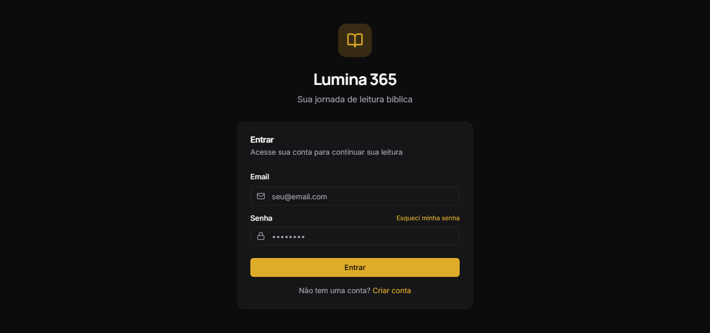
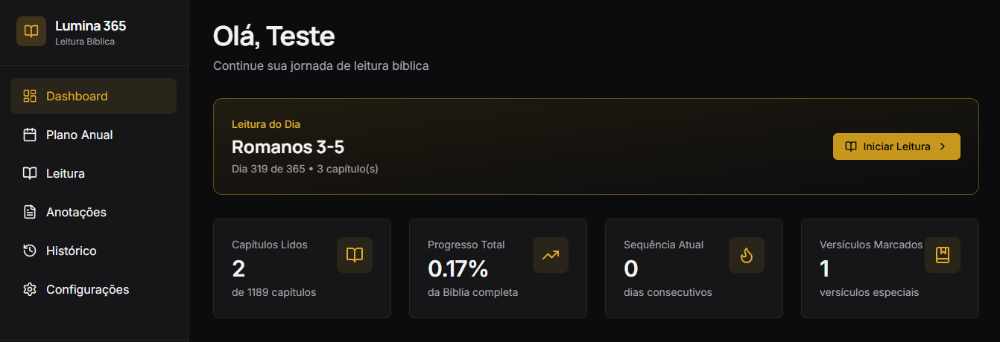
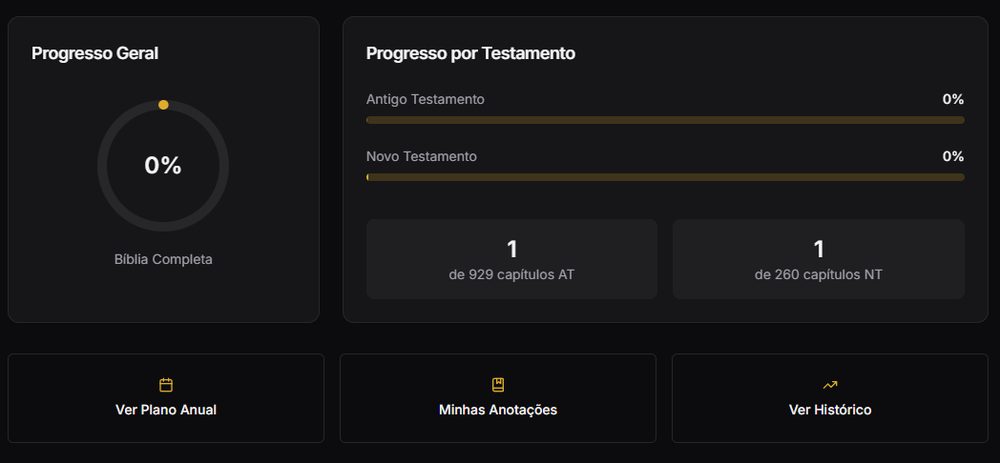
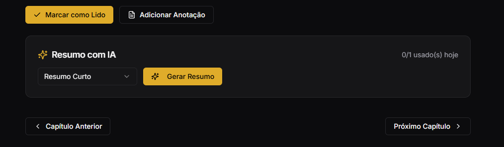
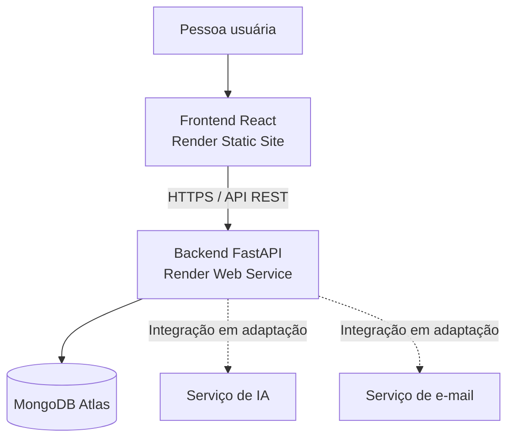

# 📖 Lumina 365

### Leitura bíblica, organização de estudos e acompanhamento de progresso em uma única aplicação

**Aplicação Full Stack · Projeto pessoal · Versão beta**

[**Conhecer a aplicação**](https://lumina-365.onrender.com) · [**Ver capturas de tela**](#-demonstração-visual) · [**Tecnologias**](#-tecnologias-e-arquitetura)

---

## ✨ Visão geral

O **Lumina 365** é uma aplicação web criada para ajudar pessoas a estabelecer uma rotina de leitura bíblica, acompanhar os capítulos concluídos e organizar seus estudos em um ambiente único.

O projeto nasceu de uma necessidade prática: reunir **leitura, planejamento, acompanhamento e anotações** em uma experiência simples, com indicadores visuais que permitem observar a evolução ao longo do tempo.

Além de representar um produto digital em desenvolvimento, o Lumina 365 também é um **projeto de aprendizado e portfólio**, envolvendo criação assistida por IA, controle de versão, backend, banco de dados e implantação em nuvem.

> **Status: beta.** A interface e as funções centrais de autenticação e acompanhamento de leitura já foram demonstradas em testes. Recursos dependentes de serviços externos, como resumos por IA e recuperação de senha por e-mail, ainda precisam de integração independente e validação antes do lançamento.

## 🚀 Funcionalidades

| Recurso | Descrição | Situação |
| :--- | :--- | :--- |
| Cadastro e login | Acesso individual à plataforma | Testado na versão hospedada |
| Leitura por livros e capítulos | Navegação pelos conteúdos de leitura | Interface disponível |
| Marcação de capítulos lidos | Registro e atualização do progresso | Testado com persistência após atualização da página |
| Dashboard | Visão geral dos capítulos lidos e percentual de conclusão | Disponível |
| Progresso por testamento | Indicadores separados para Antigo e Novo Testamento | Disponível |
| Plano anual | Acesso à organização da rotina de leitura | Interface disponível; fluxos completos ainda não validados |
| Anotações e histórico | Áreas para registrar e consultar a jornada | Interfaces disponíveis; fluxos completos ainda não validados |
| Resumos com IA | Interface para gerar resumos de capítulos | Integração independente pendente |
| Recuperação de senha | Fluxo de recuperação por e-mail | Serviço de e-mail independente pendente |

## 🖼️ Demonstração visual

As imagens abaixo mostram telas reais da aplicação durante o desenvolvimento e os testes. Os dados apresentados são de uma conta de teste.

### 1. Acesso à plataforma

Interface de login com identidade visual em tema escuro e destaque dourado.

### 2. Dashboard de leitura

Painel principal com leitura do dia, capítulos concluídos, progresso total, sequência de leitura e versículos marcados.

### 3. Indicadores de progresso

Visualização do progresso geral e do acompanhamento separado entre Antigo e Novo Testamento.

### 4. Ferramentas disponíveis na leitura

Controles para marcar capítulos como lidos, adicionar anotações, navegar entre capítulos e acessar a interface de resumos com IA. **A geração de resumos ainda está em adaptação para um provedor independente.**

> A quarta captura foi recortada para não reproduzir o texto de uma tradução bíblica sujeita a direitos autorais.

## 🛠️ Tecnologias e arquitetura

| Camada | Tecnologias |
| :--- | :--- |
| Frontend | React, JavaScript, Tailwind CSS, CRACO |
| Backend / API | Python, FastAPI, Uvicorn |
| Banco de dados | MongoDB Atlas, Motor / PyMongo |
| Hospedagem | Render (Static Site + Web Service) |
| Versionamento | Git e GitHub |
| Desenvolvimento assistido por IA | Emergent e ferramentas de IA utilizadas na construção e na resolução de problemas |

### Implantação independente

O aplicativo começou a ser desenvolvido no **Emergent**, com apoio de IA. Posteriormente, foi exportado e colocado em uma estrutura independente, separando o **frontend React**, o **backend FastAPI** e o **banco MongoDB Atlas**. A publicação no Render permite testar a aplicação por um endereço web próprio, sem depender da hospedagem original.

## 🧩 Processo de desenvolvimento e aprendizados

Minha atuação no projeto incluiu:

- Definição do objetivo, das funcionalidades e da experiência desejada para o usuário.
- Uso de ferramentas de IA para apoiar a implementação e a evolução do produto.
- Recuperação e organização do código em um repositório Git, com verificação inicial de arquivos sensíveis antes da publicação.
- Configuração do repositório remoto no GitHub e gerenciamento de commits.
- Configuração dos serviços de frontend, backend e banco de dados no Render e no MongoDB Atlas.
- Investigação de problemas reais de implantação, incluindo dependências incompatíveis, conexão TLS com o banco de dados e rotas do React que retornavam **404** ao atualizar a página.
- Validação inicial do cadastro, do login e da persistência dos capítulos marcados como lidos.

**Transparência sobre o uso de IA:** parte do código foi gerada com auxílio de ferramentas de inteligência artificial. Meu foco neste projeto foi conduzir a construção do produto, compreender sua estrutura, configurar os serviços e solucionar problemas de integração e publicação. Não apresento todo o código como escrito manualmente do zero.

## 🗺️ Próximas melhorias

- [ ] Conectar os resumos bíblicos a um serviço independente de IA.
- [ ] Configurar envio de e-mails para recuperação de senha.
- [ ] Validar de ponta a ponta os fluxos de plano anual, anotações e histórico.
- [ ] Realizar revisão adicional de segurança e testes com usuários.
- [ ] Verificar licenciamento do conteúdo bíblico e adequá-lo à distribuição pública/comercial.
- [ ] Avaliar recursos premium e um modelo de monetização após estabilização do produto.

## 🔗 Acesso e repositório

**Aplicação web (ambiente beta):** https://lumina-365.onrender.com

**Código-fonte:** mantido em repositório **privado** por se tratar de um produto em desenvolvimento, com possibilidade de exploração comercial no futuro.

Este repositório público é destinado à **apresentação técnica e visual do projeto**, sem incluir o código da aplicação nem credenciais.

> **Nota sobre disponibilização:** antes de divulgar amplamente ou comercializar o aplicativo, é necessário resolver os direitos de uso da tradução bíblica atualmente integrada, além de finalizar as validações de segurança e de serviços externos. A presença de um link de demonstração não significa que o produto já esteja pronto para lançamento comercial.

---

**Lumina 365** · Projeto pessoal de desenvolvimento web, automação e aprendizado com IA

